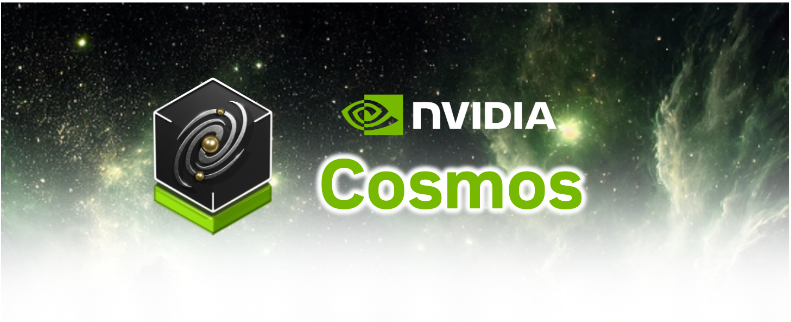
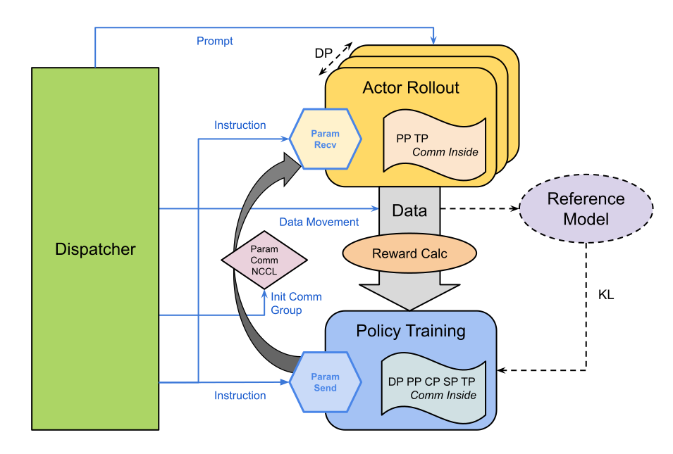

> [!IMPORTANT]
> ## Cosmos-RL has moved to [Cosmos Framework](https://github.com/NVIDIA/cosmos-framework)
>
> Post-training for Cosmos models is now developed in **[NVIDIA/cosmos-framework](https://github.com/NVIDIA/cosmos-framework)**: offline SFT, DPO, GRPO, actor-critic PPO, on-policy distillation (OPD), and DiffusionNFT, plus Joint PPO recipes for embodied policies. All of them run on one stack that scales from a single GPU to a multinode Ray cluster.
>
> **Start here:** [Cosmos Framework post-training docs](https://github.com/NVIDIA/cosmos-framework/blob/main/docs/posttrain/index.md)
>
> This repository is no longer under active development and will receive only limited maintenance updates. Future features, documentation, and community support will be focused on Cosmos Framework.
>
> Looking for the Cosmos 3 models? Visit [NVIDIA/cosmos](https://github.com/nvidia/cosmos).

    

## Getting Started

Cosmos-RL is a flexible and scalable Reinforcement Learning framework specialized for Physical AI applications.

[Documentation](https://nvidia-cosmos.github.io/cosmos-rl).

## System Architecture
Cosmos-RL provides toolchain to enable large scale RL training workload with following features:
1. **Parallelism**
    - Tensor Parallelism
    - Sequence Parallelism
    - Context Parallelism
    - FSDP Parallelism
    - Pipeline Parallelism
2. **Fully asynchronous (replicas specialization)**
    - Policy (Consumer): Replicas of training instances
    - Rollout (Producer): Replicas of generation engines
    - Low-precision training (FP8) and rollout (FP8 & FP4) support
3. **Single-Controller Architecture**
    - Efficient messaging system (e.g., `weight-sync`, `rollout`, `evaluate`) to coordinate policy and rollout replicas
    - Dynamic NCCL Process Groups for on-the-fly GPU [un]registration to enable fault-tolerant and elastic large-scale RL training

## License and Contact

This project will download and install additional third-party open source software projects. Review the license terms of these open source projects before use.

NVIDIA Cosmos source code is released under the [Apache 2 License](https://www.apache.org/licenses/LICENSE-2.0).

NVIDIA Cosmos models are released under the [NVIDIA Open Model License](https://www.nvidia.com/en-us/agreements/enterprise-software/nvidia-open-model-license). For a custom license, please contact [cosmos-license@nvidia.com](mailto:cosmos-license@nvidia.com).
