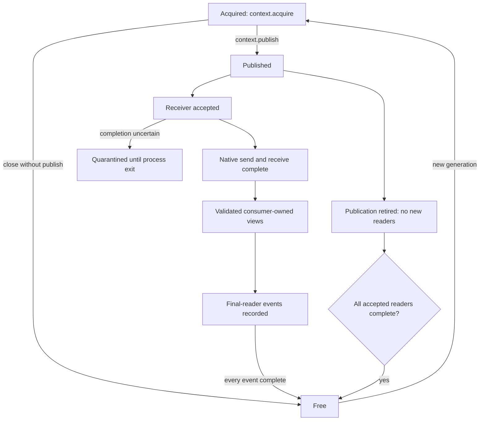
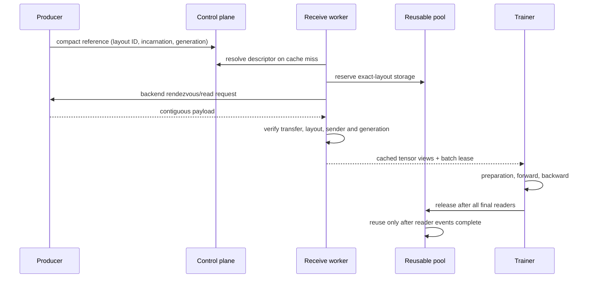

# Efficient tensor payload transport

Cosmos-RL compiles a tensor schema into one immutable aligned layout, transfers
one contiguous payload per rollout, and exposes received fields as views of
reusable backing storage. The transport—not the application—owns allocation,
publication, native-operation lifetime, and final buffer reuse.

This path is shared by NCCL and UCXX. The backends use different memory routes,
but they use the same `TensorLayout`, compact-reference, and ownership rules.

## Data flow

```mermaid
flowchart LR
    S[TensorSpec schema] --> L[Compile aligned TensorLayout]
    L --> C[Register descriptor once]
    C --> A{Producer path}
    A -->|Direct| W[Write into transport-owned views]
    A -->|Borrowed NCCL allocation| W
    A -->|Adapter| P[Normalize and pack ordinary tensors]
    W --> R[Publish compact PayloadRef]
    P --> R
    R --> X[Resolve layout ID and reserve receive storage]
    X --> N[One native payload transfer]
    N --> V[Validate wire identity]
    V --> T[Cached typed views]
    T --> F[Forward / backward / preparation]
    F --> E[Final-reader events]
    E --> Q[Return storage to bounded pool]
```



The network path was already contiguous. The important change is at the receive
boundary: fields no longer need one clone each merely to obtain aligned typed
storage.

## Physical layout

Logical schema order and physical byte order are separate. Fields remain
addressable by their schema names, while the compiler groups compatible dtype
alignments and adds explicit padding.

```text
Logical fields                 One aligned payload allocation

flag:   bool[3]       ───────▶  [ flag 3B ][ pad ]
scalar: int64[]       ───────▶  [ scalar 8B          ]
empty:  float32[0,7]  ───────▶  [ zero-byte view      ]
values: float32[2,3]  ───────▶  [ values 24B          ][ tail padding ]
                                  ▲ every typed offset is dtype-aligned
                                  └ payload extent is 64-byte aligned
```

`TensorLayout` caches shapes, dtypes, byte counts, offsets, padding ranges, and a
content-derived layout ID. Descriptors are canonical JSON with bounded size;
malformed, noncanonical, oversized, or identity-mismatched descriptors are
rejected before payload allocation. The layout alignment may not exceed the
64-byte transport framing boundary, which also aligns every UCXX ring slot.
Scalars and empty tensors are supported.

Only padding bytes are initialized on slot reuse. Payload fields must be fully
written by the direct producer or by the ordinary-tensor adapter. Because
in-place PyTorch writes cannot be observed through the mapping, the direct API
requires the caller to attest completed fields before publication; an omitted
attestation fails before the transport accepts the slot.

## Producer API

Applications compose a `PayloadContext`; they do not inherit a backend producer
mixin. Backend setup arguments are the same values previously supplied to the
rollout transport setup.

```python
from cosmos_rl.utils.payload_transport import PayloadContext

payloads = PayloadContext.create(
    "nccl",
    replica_id=replica_id,
    rollout_idx=rollout_idx,
    redis_client=redis_client,
    schema=tensor_specs,
    max_steps=max_steps,
    obs_dim=obs_dim,
    action_dim=action_dim,
    device=device,
)

# Adapter path for already-produced tensors. This uses bounded foreach batches
# and can fall back to field copies when a tensor combination is unsupported.
reference = payloads.publish_tensors(tensors)
publish_to_controller(reference.to_dict())

# Reject an unsupported batched gather instead of silently falling back.
reference = payloads.publish_tensors(tensors, copy_policy="strict_batched")

# Direct path. No second full-payload staging allocation is introduced.
slot = payloads.acquire()
produce_into(slot.tensors)
slot.mark_all_written()
reference = payloads.publish(slot, ready_event=producer_ready_event)
publish_to_controller(reference.to_dict())

# NCCL can also borrow one compatible application allocation. The requirement
# object accounts for framing without exposing backend constants.
requirements = payloads.storage_requirements()
wire = allocate_application_tensor(
    requirements.total_nbytes,
    dtype=requirements.dtype,
    device=requirements.device,
)
borrowed = payloads.borrow(
    wire,
    owner=application_lease,
    on_release=application_lease.release,
)
produce_into(borrowed.tensors)
borrowed.mark_all_written()
reference = payloads.publish(borrowed, ready_event=producer_ready_event)

payloads.close()
```

### Construction arguments

`PayloadContext.create()` forwards backend setup values without exposing the
backend producer object. The application still owns control-plane discovery and
selects the schema; the context owns everything after attachment.

| Argument | NCCL | UCXX | Meaning |
| --- | :---: | :---: | --- |
| `replica_id` | required | required | Globally unique producer identity for this process |
| `schema` | optional | optional | Sequence of `TensorSpec`; the default trajectory schema is used when omitted |
| `max_steps`, `obs_dim`, `action_dim` | required | required | Inputs for the default trajectory schema |
| `rollout_idx` | required | — | Cleanup-routing index encoded in NCCL transfer IDs |
| `redis_client`, `config` | required | — | NCCL control plane and transport tuning |
| `device` | optional | — | Device holding NCCL publication storage |
| `sender_rank` | optional | — | Rank used inside the producer/consumer communicator |
| `port`, `config` | — | optional | UCXX listener selection and `UCXXBufferConfig` |
| `layout_cache_capacity` | optional | optional | Maximum number of producer layouts retained by the public context |

NCCL can register more than one layout up to the configured capacity. A UCXX
shared-memory ring has one physical slot layout, so its context accepts only the
layout created at setup. `PayloadContext.close()` stops new publication first,
abandons every unpublished acquired slot, and then performs backend teardown. A
teardown still running at the caller deadline remains owned and can be waited on
by another `close()` call. A teardown that actually fails remains failed; it is
never reported as a successful close or silently re-run against uncertain
native state.

Register a non-default schema before using it:

```python
layout = payloads.register_layout(other_tensor_specs)
reference = payloads.publish_tensors(other_tensors, layout=layout)
```

Registration is explicit. Passing an unregistered layout fails instead of
embedding an untrusted descriptor in every reference. UCXX shared-memory rings
have one layout fixed at creation and reject a different registration. NCCL can
publish multiple registered layouts through its control-plane registry.

`PayloadRef` is immutable and contains transfer identity, layout identity, wire
version, sender incarnation, backend addressing, and bounded application
metadata. The full field list is resolved separately on a cache miss.

Borrowing is capability-based. NCCL accepts a contiguous `uint8` allocation
matching `storage_requirements()` and retains the supplied owner until all
accepted sends are proven complete. The callback runs once after safe retirement
or abandonment. If native completion is uncertain, the owner is quarantined and
the callback does not run. UCXX rejects arbitrary borrowed allocations: its
publishable storage is the shared-ring slot returned by `acquire()`, because an
external allocation cannot become remotely addressable without a copy or a new
registration protocol.

## Ownership state machine



Publishing transfers ownership away from the producer. A caller must not mutate
captured tensor aliases after publication. Received tensors remain valid until
the consumer releases the batch after every CPU reader and every GPU stream has
finished. `release_prefetch(streams=...)` records and waits for final-reader
events before a slot can re-enter the pool.

### UCXX connection admission

UCXX keeps two reusable connections per producer listener. Reads share a
per-listener admission limit of the same size: a large batch queues excess
requests instead of opening connections that would immediately exceed the
idle pool and be closed. Independent listeners retain independent concurrency.
This optimizes connection reuse, not the wire format or host staging route.

```text
queued read (destination owned, deadline running)
  -> listener permit
  -> reuse/connect endpoint -> request/status/payload
  -> return healthy endpoint to pool -> complete operation -> release permit
```

The existing operation deadline includes admission wait. Cancellation or an
uncertain completion retains the operation, its destination and waiter and
makes the client terminal; it is never permission to recycle storage or retry
an accepted transfer. A queued read also prevents client teardown. Clean stale
slot rejection and safely completed transport errors retain their existing
handling. Idle endpoint expiry and healthy-port rotation are unchanged.

This bounds active payload connections **per listener**, not total host memory
or the number of producer listeners. The existing batch may still own queued
receive destinations. GPU placement remains one bulk H2D copy followed by
aligned views; direct GPU UCXX receive and CPU sidecars are not implemented.

### Custom trainer adoption

Every training invocation must consume the rollout identities admitted for that
invocation. Do not rotate a previous invocation's rollout list locally and then
acknowledge the current invocation: that trains the wrong batch and can leave
the final batch unconsumed. Cross-step lookahead requires controller/worker
scheduling support; the transport adapter alone does not provide that support.

For a trainer using the consumer adapter, the ordinary current-batch pattern is:

```python
def step_training(self, rollouts, **kwargs):
    try:
        return self._train_current_batch(rollouts, **kwargs)
    finally:
        # The inner frame must not retain received aliases on the trainer.
        self.data_packer.release_prefetch(streams=(self.train_stream,))

def _train_current_batch(self, rollouts, **kwargs):
    self.data_packer.start_prefetch(rollouts)
    self.data_packer.wait_prefetch()
    # Resolve these same rollouts, then prepare model inputs on this stream.
    batch = self.prepare_inputs(rollouts)
    self.train_stream.wait_stream(torch.cuda.current_stream())
    with torch.cuda.stream(self.train_stream):
        return self.train_inputs(batch, **kwargs)
```

`prepare_inputs` and `train_inputs` above are application methods, not new
Cosmos-RL APIs. The returned metrics must not retain received tensor views.
Declare every additional reader stream, and release only after any CPU readers
have finished too. Persistent replay/history must own independent storage.
Use the same final-reader discipline on exceptions. The pool's event fence
protects reuse; it does not replace the preparation-to-training stream
dependency. A controller-managed prefetch scope can reuse its already-admitted
batch through the adapter, but the trainer must not replace that batch or start
an independent previous-batch rotation.

The cached view mapping tracks keys a consumer replaces, removes, or adds. On
reuse it repairs only those dirty keys (plus variable-length fields), preventing
one batch's dictionary mutations from poisoning the next batch without
reconstructing every view in the common case.

`mark_written(*names)` supports producers that populate fields in stages;
`mark_all_written()` is the concise form when one operation overwrites the full
layout. These methods attest complete writes, not merely valid prefixes. A
variable-length producer must initialize the unused capacity required by its
layout (normally with the same deterministic padding semantics as the adapter)
before marking that field written.

### Producer observability

`PayloadContext.metrics()` returns a detached read-only snapshot. Adapter
counters describe work attempted even if later publication falls back; direct
and borrowed counters advance only after the backend accepts publication.
Convert the snapshot with `dict(context.metrics())` before JSON serialization.

| Counter | Meaning |
| --- | --- |
| `adapter_payloads` | Ordinary tensor mappings packed into contiguous storage |
| `adapter_fields` | Schema fields processed by the adapter |
| `adapter_bytes` | Field bytes copied, excluding alignment padding |
| `adapter_copy_batches` | Successful `torch._foreach_copy_` groups |
| `adapter_fallback_fields` | Fields copied individually after an unsupported group |
| `direct_payloads` | Transport-owned slots accepted for publication |
| `borrowed_payloads` | Application-owned NCCL allocations accepted for publication |

UCXX snapshots also include ring writes, reads, drops, ready slots, and total
slots. A nonzero `adapter_fallback_fields` value is the signal to inspect source
layout/device combinations or enable `strict_batched` during qualification.

## Backend memory routes

| Backend and destination | Storage route | Post-receive field copies |
| --- | --- | ---: |
| NCCL to GPU | Reusable CUDA send buffer → NCCL → reusable CUDA receive buffer | 0 |
| UCXX to CPU | Shared-memory slot → reusable pinned host receive buffer | 0 |
| UCXX to GPU | Shared-memory slot → reusable pinned host buffer → one bulk H2D copy into reusable CUDA storage | 0 per field; one payload placement copy |

UCXX direct GPU receive is not implied by selecting UCXX or by an RDMA-capable
network. The implemented GPU route is explicit host staging plus one bulk copy.
NCCL CPU destinations and mixed CPU/GPU payload segments are not exposed by this
API; callers must use a supported route rather than assuming silent placement.

## Receive sequence



For NCCL, layout descriptors are stored under the producer replica and sender
incarnation in Redis. For UCXX, the client queries the producer server on a cache
miss. A restarted producer has a new incarnation, so an old reference cannot
resolve or consume storage from the new process. UCXX slot generations prevent a
reused ring position from satisfying an older reference.

## Bounds and backpressure

- Layout caches have a fixed entry capacity.
- Receive admission reserves the complete returned batch while its zero-copy
  views are leased. A batch larger than `nccl_receive_budget_bytes` is rejected
  before native receive.
- Reusable pools are bounded both per layout and across layouts. When a new
  layout would exceed the configured byte bound, idle storage from older layouts
  is evicted before allocating the new buffer.
- A consumer-owned batch can apply backpressure to the next prefetch. The
  training step is not treated as a transport timeout, but callers must release
  the previous batch before collecting another one that needs its capacity.
- Uncertain native work is quarantined, not recycled to satisfy a bound.

`payload_receive_pool_cached_slots` limits cached NCCL receive slots. When
`nccl_receive_budget_bytes` is configured, it also bounds idle pooled receive
bytes. Producer registry capacity bounds admitted send payloads; a native
operation with uncertain completion remains owned even if that temporarily
exceeds the normal reusable-cache target.

## Failure contract

These conditions fail before training consumes the payload:

- unsupported wire version;
- missing, malformed, or noncanonical layout descriptor;
- layout ID or payload-size disagreement;
- wrong transfer identity or sender incarnation;
- stale UCXX slot generation;
- receive-budget rejection;
- accepted native operation whose completion becomes uncertain.

An accepted operation is never converted into an ordinary missing sample. A
timeout or Python cancellation is not proof that NCCL, UCXX, or CUDA stopped
using a buffer. Such storage remains owned and the transport becomes unusable;
process-level restart is the recovery boundary.

## Compatibility

`NCCLRolloutMixin` and `UCXXRolloutMixin` were removed. Producer applications
must own `PayloadContext` directly. `NCCLDataPackerMixin` and
`UCXXDataPackerMixin` remain as consumer integration adapters because existing
trainers use their prefetch lifecycle.

The deprecated `redis_client` assignment followed by
`post_redis_injection()` remains supported for AlpaGym's independent cleanup
lifecycle. It is not a producer wire-format adapter.

Every producer and consumer in a job must launch from the same Cosmos-RL build.
There is no rolling mixed-wire upgrade. Wire-version and sender-incarnation
checks exist to reject stale references from an earlier process or job.

## Current optimization boundary

The owned-view receive path removes per-field receive clones and reuses layouts,
allocations, and view objects. The direct producer path avoids a full-payload
gather when the application can write into transport-owned views. NCCL also
accepts a compatible application-owned allocation through an explicit lease.

The ordinary-tensor adapter still validates and copies separately allocated
source tensors into the contiguous send payload. It submits bounded
`torch._foreach_copy_` groups instead of one Python-dispatched copy per field;
the default policy records and permits a per-field fallback, while
`strict_batched` rejects an unsupported group. Placement-aware CPU sidecars and
direct UCXX CUDA receive require separate capability and performance work. They
must report their copies rather than being described as zero-copy behavior.

The UCXX ordinary GPU adapter reuses one serialized GPU staging allocation per
producer device and one pinned-host staging allocation. It still performs a
field gather, one payload D2H copy, and one shared-memory copy. Applications
with ordinary CPU tensors are batched directly into a reserved shared-memory
slot, without a normalized dictionary or a second per-field ring copy.
Applications that need a no-gather UCXX path can produce into the CPU views
returned by `acquire()`; applications that need direct GPU publication should
select NCCL.
